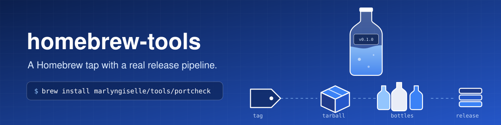
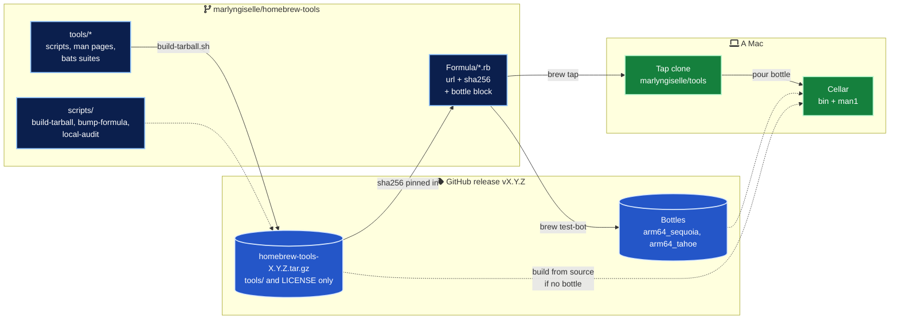
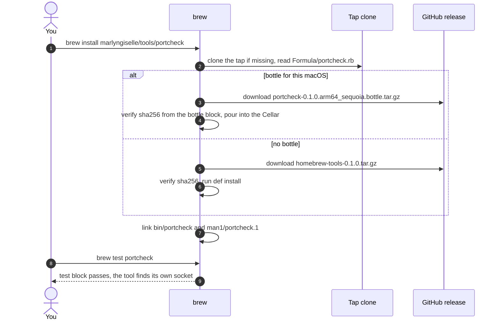

<div align="center">



<h3>A Homebrew tap that ships its own tools the way serious projects ship macOS software.</h3>


</div>

---

## In numbers

| | |
| --- | --- |
| 3 | Formulae, each with a man page and a `test do` block that checks real behaviour |
| 66 | bats tests across the three tools and the release scripts, all passing on the macOS system bash 3.2 |
| 0 | Runtime dependencies beyond macOS itself, except `jq` for one tool |
| 1 | Tag to start a release. Tarball, GitHub release, bottles and the formula pull request follow on their own |
| 2 | macOS versions every formula is built, tested and bottled on (macOS 15 and macOS 26) |
| 5 | Actions used by the workflows, every one pinned to a full commit SHA |
| 0 | Workflow steps that push to `main` |
| 3 | Architecture decision records |

## What it is

A personal Homebrew tap, `marlyngiselle/tools`, and the small command-line tools it installs. The tools live in this repository, so the tap is self-contained and every change to a tool, its tests and its formula is one pull request.

The point is the delivery. Formulae install from a reproducible, checksum-pinned release tarball, CI runs `brew test-bot` on real macOS runners, and a single tag produces a GitHub release with bottles and a pull request that bumps every formula. It is the pipeline Homebrew uses for its own repositories, adapted to a tap that releases its own code.

## The formulae

| Formula | What it answers | Highlights |
| --- | --- | --- |
| [`portcheck`](tools/portcheck/portcheck) | Who is listening on port 3000, and can I stop it safely? | Read-only by default. `--kill` sends SIGTERM after a confirmation, SIGKILL only with `--force`, never touches PID 1, launchd or another user's process. `--json`, `--dry-run` |
| [`wifi-diag`](tools/wifi-diag/wifi-diag) | Is it the Wi-Fi, the gateway, DNS or a captive portal? | Interface, network name, IP, gateway, DNS, then five checks with latency and loss. Only built-in macOS commands, no sudo. `--json`, `--no-network` |
| [`brew-outdated-report`](tools/brew-outdated-report/brew-outdated-report) | What is outdated on this Mac, and how big is each jump? | Markdown report with major, minor, patch and rebuild classification, sorted by severity, upgrade commands with pinned formulae left out. Reproducible with `SOURCE_DATE_EPOCH` |

Every tool has `--help`, `--version`, a man page and documented exit codes, so it behaves the same for a person in a terminal and for a script in CI.

## Quick start

```bash
brew tap marlyngiselle/tools
brew install portcheck wifi-diag brew-outdated-report
```

Or install a single formula without tapping first.

```bash
brew install marlyngiselle/tools/portcheck
```

```bash
portcheck 3000
wifi-diag --json | jq '.checks[] | select(.status != "ok")'
brew-outdated-report --output ~/Desktop/outdated.md
man portcheck
```

<details>
<summary>Sample output of <code>portcheck</code></summary>

```console
$ portcheck 3000
PID      COMMAND              USER           ADDRESS
48213    node                 dev            *:3000,[::]:3000
$ portcheck --kill --dry-run --force 3000
PID      COMMAND              USER           ADDRESS
48213    node                 dev            *:3000,[::]:3000
DRY-RUN: kill -TERM 48213
DRY-RUN: kill -KILL 48213  # only if still running after 5s
$ portcheck --kill 3000
PID      COMMAND              USER           ADDRESS
48213    node                 dev            *:3000,[::]:3000
Stop PID 48213 (node, user dev) listening on port 3000? [y/N] y
portcheck: stopped 48213 (node) with SIGTERM
```

</details>

<details>
<summary>Sample output of <code>wifi-diag</code></summary>

```console
$ wifi-diag
wifi-diag 0.1.0, 2026-10-26T09:14:02Z

Interface      en0 (Wi-Fi)
Wi-Fi network  hidden by macOS (grant Location Services to the terminal to show it)
IPv4 address   192.0.2.23
Gateway        192.0.2.1
DNS servers    192.0.2.1, 198.51.100.53

CHECK              RESULT   DETAIL
default_route      ok       via 192.0.2.1 on en0
gateway_latency    ok       avg 2.500 ms to 192.0.2.1, 0% loss
internet_latency   ok       avg 14.200 ms to 1.1.1.1, 0% loss
dns_resolution     ok       apple.com resolved to 198.51.100.10
captive_portal     ok       open internet, captive.apple.com answered Success

Overall: ok
```

</details>

<details>
<summary>Sample output of <code>brew-outdated-report</code></summary>

```markdown
## Summary

| Metric | Count |
| --- | --- |
| Outdated formulae | 5 |
| Outdated casks | 1 |
| Major upgrades | 1 |
| Pinned, held back | 1 |

## Formulae

| Name | Installed | Latest | Change | Pinned |
| --- | --- | --- | --- | --- |
| `node` | 22.9.0 | 24.1.0 | major | no |
| `git` | 2.47.0 | 2.48.1 | minor | no |
| `postgresql@16` | 16.3 | 16.4 | minor | yes |
| `zstd` | 1.5.6 | 1.5.7 | patch | no |
| `jq` | 1.7.1 | 1.7.1_1 | rebuild | no |
```

</details>

Samples use synthetic data and the documentation address ranges `192.0.2.0/24` and `198.51.100.0/24`.

## How it fits together



The formulae never install from the working tree. They install from a tarball attached to a GitHub release and pinned by `sha256`, exactly like a formula in Homebrew's core repository. The tarball holds `tools/` and `LICENSE` but not `Formula/`, so writing a checksum into a formula never changes the tarball it describes ([ADR 0002](docs/adr/0002-reproducible-tarball-without-formulae.md)).

## What happens on `brew install`



## Release pipeline

```mermaid
flowchart LR
    tag["fa:fa-tag git push<br/>tag v0.2.0"] --> src

    subgraph S["source, ubuntu-24.04"]
        src["fa:fa-check tag on main?"] --> tb["fa:fa-archive build-tarball.sh<br/>reproducible"]
        tb --> pre["fa:fa-upload GitHub release<br/>prerelease + tarball"]
    end

    subgraph B["bottles, macos-15 and macos-26"]
        bump1["fa:fa-pen bump-formula.sh<br/>local commit"] --> bot["fa:fa-flask brew test-bot<br/>install, test, audit, bottle"]
    end

    subgraph P["publish, environment release"]
        bump2["fa:fa-code-branch branch release/v0.2.0<br/>bump-formula.sh"] --> up["fa:fa-box brew pr-upload<br/>bottle blocks + assets"]
        up --> pr["fa:fa-code-pull-request push branch,<br/>open pull request"]
        pr --> fin["fa:fa-flag-checkered release final<br/>and latest"]
    end

    pre --> bump1
    bot -- "bottle artifacts" --> bump2
    fin --> merge{"fa:fa-user-check maintainer<br/>merges"}
    merge --> users["fa:fa-download brew upgrade<br/>gets v0.2.0"]

    classDef trig fill:#0b1f4d,stroke:#93c5fd,color:#fff,stroke-width:2px
    classDef job fill:#2456c8,stroke:#dbeafe,color:#fff,stroke-width:2px
    classDef gate fill:#b45309,stroke:#fde68a,color:#fff,stroke-width:2px
    classDef ok fill:#15803d,stroke:#bbf7d0,color:#fff,stroke-width:2px
    class tag trig
    class src,tb,pre,bump1,bot,bump2,up,pr,fin job
    class merge gate
    class users ok
```



| Job | Token permissions | Writes |
| --- | --- | --- |
| `source` | `contents: write` | The GitHub release, the tarball and its `.sha256` |
| `bottles` | `contents: read` | Nothing outside the runner |
| `publish` | `contents: write`, `pull-requests: write` | Bottle assets, the `release/<tag>` branch, one pull request |

Pull requests run `tests.yml`, which covers ShellCheck, `ruby -c` and actionlint, the 66 bats tests on `/bin/bash` 3.2, a check that every formula's `sha256` matches a fresh rebuild of its tag, and `brew test-bot` on macOS 15 and macOS 26. The full walkthrough, including re-runs and the classic `brew pr-pull` flow, is in [docs/release-process.md](docs/release-process.md).

## Before you touch anything

> [!IMPORTANT]
> Never edit `url` or `sha256` by hand. A tag produces them, and `scripts/bump-formula.sh` writes them. A hand edit that drifts from the tag fails the checksum step in `tests.yml`.

> [!WARNING]
> A new formula cannot pass `brew test-bot --only-formulae` on its first pull request, because the current release tarball does not contain its tool yet. Merge it, then tag a release. [docs/adding-a-formula.md](docs/adding-a-formula.md) walks through the three steps.

> [!CAUTION]
> `portcheck --kill --yes` removes the only interactive stop. Run the same command with `--dry-run` first and read the plan. Processes owned by other users are refused unless you run it with `sudo`.

> [!NOTE]
> The pull request that `release.yml` opens with `GITHUB_TOKEN` does not trigger `tests.yml` by itself. Its bottles were already built and tested in the release run. Close and reopen it to get the usual checks too.

## Repository map

| Path | Role |
| --- | --- |
| `Formula/` | `portcheck.rb`, `wifi-diag.rb`, `brew-outdated-report.rb` |
| `tools/<name>/` | The tool, its man page, its bats suite and the stubs it runs against |
| `scripts/build-tarball.sh` | Reproducible source tarball from `tools/` and `LICENSE` |
| `scripts/bump-formula.sh` | Rewrites `url` and `sha256`, drops stale bottles and revisions, `--check` for CI |
| `scripts/local-audit.sh` | The CI checks on a laptop, with `brew style` and `brew audit` when available |
| `tests/scripts.bats` | Tests for the bump and the tarball, including byte-for-byte reproducibility |
| `.github/workflows/tests.yml` | Lint, unit tests, checksum check, `brew test-bot` on pull requests |
| `.github/workflows/release.yml` | Tag to tarball, release, bottles and formula pull request |
| `.github/dependabot.yml` | Weekly updates for the pinned actions |
| `docs/` | How the tap works, the release process, adding a formula, decision records |
| `Makefile` | `make lint`, `make test`, `make audit`, `make tarball` |

## Documentation

| Document | What it covers |
| --- | --- |
| [How the tap works](docs/how-the-tap-works.md) | Taps, the anatomy of a formula, one tarball for several formulae, bottles, what CI checks |
| [Release process](docs/release-process.md) | The pipeline step by step, permissions, re-runs, the `brew pr-pull` flow |
| [Adding a formula](docs/adding-a-formula.md) | A new tool and its formula in three steps, with the house rules |
| [ADR 0001](docs/adr/0001-tools-and-formulae-in-one-repository.md) | Why the tools live in the tap |
| [ADR 0002](docs/adr/0002-reproducible-tarball-without-formulae.md) | Why the release tarball is built here, and how it stays reproducible |
| [ADR 0003](docs/adr/0003-tag-driven-release-with-pull-request.md) | Why a tag starts the release and a pull request ends it |

---

<div align="center">
<sub>MIT licensed · © 2026 Giselle Da Costa · <a href="LICENSE">LICENSE</a></sub>
</div>
