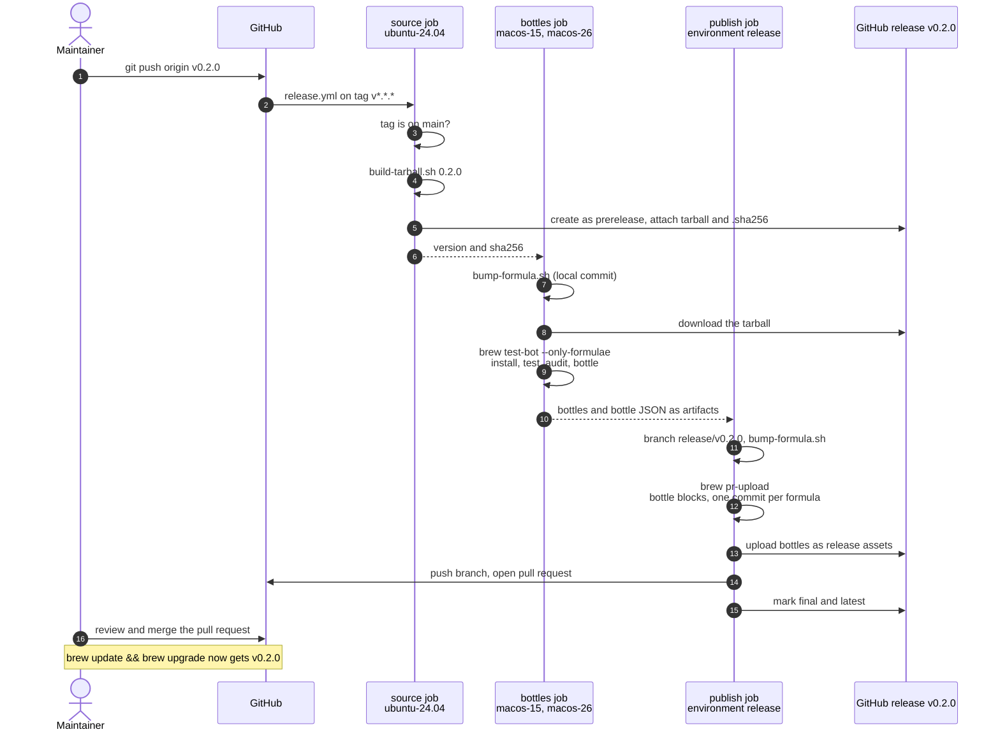

# Release process

A release is one annotated tag on `main`. Everything after the tag is automated, and the only step that changes what users install is a pull request that a person merges.

```bash
git switch main && git pull
git tag -a v0.2.0 -m "v0.2.0"
git push origin v0.2.0
```

## The pipeline



| Job | Runner | Token permissions | Writes |
| --- | --- | --- | --- |
| `source` | ubuntu-24.04 | `contents: write` | The release and its tarball |
| `bottles` | macos-15, macos-26 | `contents: read` | Nothing outside the runner |
| `publish` | ubuntu-24.04, environment `release` | `contents: write`, `pull-requests: write` | Bottle assets, the `release/<tag>` branch, one pull request |

The workflow never pushes to `main`, never force-pushes a shared branch, and never deletes a tag or a release.

## What each step guarantees

| Step | Guarantee |
| --- | --- |
| Tag pattern `v[0-9]+.[0-9]+.[0-9]+` | Only plain semantic versions start a release |
| Ancestry check | A tag on a feature branch fails before anything is published |
| `build-tarball.sh` | Same `tools/` tree, same bytes, same `sha256` on any machine (see [ADR 0002](adr/0002-reproducible-tarball-without-formulae.md)) |
| Prerelease first | `brew` can download the tarball while bottles are built, and users do not see a release without bottles as latest |
| `bump-formula.sh` | `url` and `sha256` rewritten in every formula, stale bottle blocks and revisions removed |
| `brew test-bot --only-formulae` | Each formula installs, passes `brew test` and `brew linkage`, and bottles on both macOS versions |
| `brew pr-upload` | Bottle JSON from both runners merged into one `bottle do` block per formula, bottles uploaded under the names Homebrew expects |
| Pull request | A human sees the exact diff that will reach users |

## Re-running a failed release

Every step is safe to repeat. Re-run the failed jobs from the Actions tab.

| Failed in | What a re-run does |
| --- | --- |
| `source` | Uploads the tarball again with `--clobber`. The bytes are identical, so the checksum does not move |
| `bottles` | Rebuilds the bottles from scratch |
| `publish` | Re-creates the branch from the tag, re-uploads bottles, force-pushes only `release/<tag>` with a lease, and skips opening a second pull request |

To abandon a release, close the pull request, delete the `release/<tag>` branch and the GitHub release, then the tag. Nothing reached users, because the formulae on `main` were never changed.

## Known limits

> [!NOTE]
> A pull request opened with the workflow's `GITHUB_TOKEN` does not trigger other workflows, so `tests.yml` does not run on it automatically. The bottles in it were already built and tested by the release run. To get the usual checks as well, close and reopen the pull request, or let the publish job open it with a GitHub App token.

> [!IMPORTANT]
> Add required reviewers to the `release` environment (Settings, Environments) to hold every release before the publish job uploads anything. Protect `v*` tags with a tag ruleset so only maintainers can start a release.

## The `brew pr-pull` flow, and why this tap uses tags instead

Homebrew's own repositories, and the tap template that `brew tap-new` generates, publish bottles from pull requests.

1. A contributor opens a pull request that changes a formula.
2. `brew test-bot` builds bottles on every runner and stores them as workflow artifacts.
3. A maintainer runs `brew pr-pull <number>`, usually from a workflow started by hand or by a label. It downloads the artifacts, writes the bottle blocks, uploads the bottles and pushes the commits to `main`.

That flow fits a tap whose formulae track other people's releases. Here the code and the formulae live in the same repository, so the version is decided by a tag in this repository, and the tag is the natural trigger. `release.yml` keeps the same building blocks (`brew test-bot` for bottles, `brew pr-upload` for the bottle commit and the upload) and changes two things. It starts from a tag, and it opens a pull request instead of pushing to `main`. [ADR 0003](adr/0003-tag-driven-release-with-pull-request.md) records the decision.

The classic flow also runs by hand on a contributor's pull request, from a machine where the tap is installed.

```bash
brew pr-pull --tap=marlyngiselle/tools --root-url="https://github.com/marlyngiselle/homebrew-tools/releases/download/v0.2.0" <pull-request-number>
```
